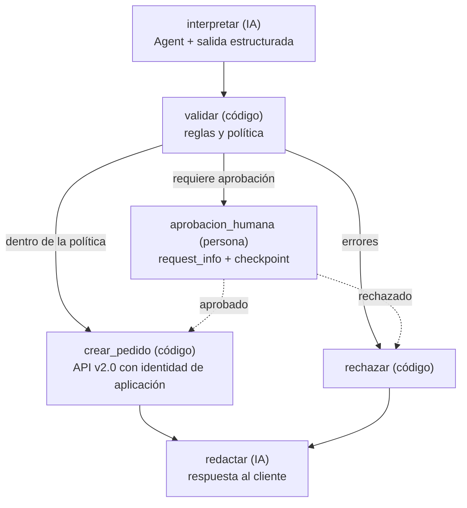
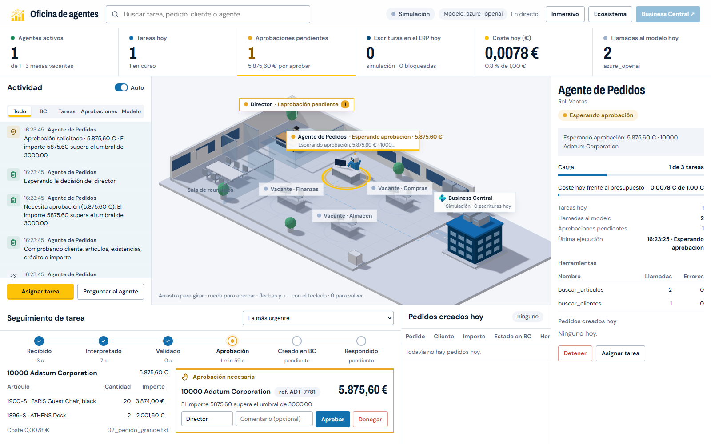

# Agente de pedidos de venta para Business Central con Microsoft Agent Framework

Un ejemplo pequeño pero completo de un agente de IA que **lee pedidos de venta llegados por correo, los valida contra Dynamics 365 Business Central y pide aprobación a una persona antes de crear los que superan un importe**. Está construido con [Microsoft Agent Framework](https://learn.microsoft.com/agent-framework/) (Python, versión 1.22.0, verificada el 17 de octubre de 2026) y acompaña al artículo *«Microsoft Agent Framework explicado desde el ERP: qué hay detrás de un agente que toca Business Central (y cuánto control te deja)»*.

El objetivo no es el pedido: es enseñar **todas las piezas del esqueleto de un agente** y, sobre todo, **quién decide qué**:

| Decide el agente (IA) | Decide el código | Decide una persona |
|---|---|---|
| Qué cliente y qué artículos nombra el correo; cómo redactar la respuesta | Si el pedido es válido (cliente no bloqueado, artículos existentes, existencias, crédito), su importe, si hace falta aprobación y qué ruta sigue; la escritura en el ERP | Si se crea un pedido que exige aprobación (importe, dudas, política) |

Funciona **sin ninguna credencial** en modo demo (modelo simulado + Business Central simulado) y se conecta a un **sandbox real** de Business Central con seis variables de entorno. Se ha probado con Azure OpenAI y contra un sandbox con CRONUS ES; lo que falló por el camino y cómo se corrigió está en [`docs/notas-de-construccion.md`](docs/notas-de-construccion.md).

> Lenguaje: Python. Framework: `agent-framework==1.22.0`. Todo el código usa la API vigente (`Agent`, `AgentSession`, `@tool`, `WorkflowBuilder`, `request_info`, `FileCheckpointStorage`, `configure_otel_providers`), no la de la beta de 2025 (`ChatAgent`, `AgentThread`, `@ai_function`…). Si usas un asistente de código, fíjale la versión: la API cambia cada semana.

---

## Índice

1. [Qué muestra el ejemplo (las piezas del esqueleto)](#1-qué-muestra-el-ejemplo-las-piezas-del-esqueleto)
2. [Los escenarios y por qué este](#2-los-escenarios-y-por-qué-este)
3. [Cómo funciona: el workflow](#3-cómo-funciona-el-workflow)
4. [Requisitos](#4-requisitos)
5. [Instalación y primera ejecución (modo demo, sin credenciales)](#5-instalación-y-primera-ejecución-modo-demo-sin-credenciales)
6. [Los comandos, uno a uno](#6-los-comandos-uno-a-uno)
7. [Conectar un modelo real](#7-conectar-un-modelo-real)
8. [Conectar un sandbox de Business Central](#8-conectar-un-sandbox-de-business-central)
9. [Observabilidad: trazas y coste](#9-observabilidad-trazas-y-coste)
10. [DevUI y servidor MCP (opcionales)](#10-devui-y-servidor-mcp-opcionales)
11. [Oficina de agentes (interfaz web)](#11-oficina-de-agentes-interfaz-web)
12. [Pruebas](#12-pruebas)
13. [Estructura del repositorio y qué hace cada archivo](#13-estructura-del-repositorio-y-qué-hace-cada-archivo)
14. [Limitaciones y siguientes pasos](#14-limitaciones-y-siguientes-pasos)
15. [Para construirlo con Claude Code](#15-para-construirlo-con-claude-code)
16. [Licencia](#16-licencia)

---

## 1. Qué muestra el ejemplo (las piezas del esqueleto)

| Pieza del esqueleto | Dónde está | Qué hace aquí |
|---|---|---|
| **Agente** (`Agent`) | `src/agente_pedidos/agentes.py` | Tres agentes: `interprete` (lee el correo), `redactor` (responde al cliente) y `asistente_pedidos` (variante de chat) |
| **Instrucciones** (system prompt) | `prompts/interprete.md`, `prompts/redactor.md`, `prompts/asistente.md` | En español, versionadas, legibles sin abrir el código |
| **Cliente de modelo** | `src/agente_pedidos/modelo.py` | `OpenAIChatClient` (OpenAI/Azure OpenAI), `FoundryChatClient` (Microsoft Foundry) o `ClienteSimulado` (sin red) según `MODELO_PROVEEDOR` |
| **Herramientas** (`@tool`) que leen y escriben en el ERP | `src/agente_pedidos/herramientas.py` | Cuatro de lectura (`buscar_clientes`, `obtener_cliente`, `buscar_articulos`, `obtener_articulo`) y una de escritura (`crear_pedido_venta`) con `approval_mode="always_require"` |
| **Acceso a Business Central** | `src/agente_pedidos/bc/` | Interfaz común `ClienteBC`; `ClienteApiV2` (API v2.0 real, OAuth cliente-credenciales) y `ClienteDemo` (datos simulados) |
| **Salida estructurada** | `src/agente_pedidos/esquemas.py` | Modelos Pydantic: `PedidoInterpretado`, `PedidoValidado`, `DecisionHumana`, `ResultadoPedido`; el intérprete responde con `options={"response_format": PedidoInterpretado}` |
| **Sesión / memoria** (`AgentSession`) | `agentes.py`, `cli.py` (comando `chat`) | El historial de la conversación; la aprobación se responde en la misma sesión |
| **Middleware** | `src/agente_pedidos/middleware.py` | `AuditoriaHerramientas` (registro JSONL de cada herramienta, también de las que fallan), `SoloLectura` (bloquea escrituras por política), `PresupuestoLlamadas` (tope de llamadas al modelo) |
| **Reglas de negocio deterministas** | `src/agente_pedidos/politicas.py` | Umbral de importe, cliente bloqueado, existencias, crédito, dudas: aquí decide el código |
| **Workflow** con aprobación humana y **checkpoints** | `src/agente_pedidos/workflow.py` | `WorkflowBuilder` con aristas condicionales, `request_info` para la parada humana, `FileCheckpointStorage` para reanudar horas después y en otro proceso |
| **Observabilidad** (trazas y coste) | `src/agente_pedidos/observabilidad.py` | `configure_otel_providers` (OpenTelemetry → Aspire, consola o Application Insights) y `ContadorCoste` (tokens → euros) |
| **MCP** | `src/agente_pedidos/mcp_server.py` | Servidor MCP opcional con las lecturas del ERP y `MCPStdioTool` para consumirlo desde el agente |
| **DevUI** | `devui/` | Entidades para la interfaz de pruebas del framework (beta) |
| **Línea de comandos** | `src/agente_pedidos/cli.py` | `demo`, `procesar`, `pendientes`, `reanudar`, `chat`, `grafo` |
| **Oficina de agentes** (interfaz web) | `ui/`, `src/agente_pedidos/eventos.py`, `src/agente_pedidos/oficina.py` | Registro de eventos (`eventos.jsonl`), backend FastAPI con SSE y torre de control con la oficina en 3D isométrico: estado de cada agente, seguimiento y aprobación de tareas, KPI de coste y enlaces a Business Central (sección 11) |
| **Pruebas** | `tests/` | 99 pruebas sin modelo real ni ERP real (incluida la reanudación desde checkpoint y la oficina de extremo a extremo) |

## 2. Los escenarios y por qué este

Se valoraron tres escenarios de ERP, todos con lectura y escritura:

| Escenario | Qué decide el agente | Qué decide el código | Qué aprueba la persona | Valoración |
|---|---|---|---|---|
| **Pedidos de venta por correo** (elegido) | Interpretar el correo: cliente, artículos, cantidades, fecha | Validez, existencias, crédito, importe, ruta | Pedidos por encima de un umbral o con dudas | Entrada no fiable (correo) + lectura del ERP + escritura: el caso más exigente de control y el más fácil de entender para cualquiera |
| Reposición de compras | Proponer cantidades a partir de consumos y mínimos | Reglas de stock mínimo y proveedores homologados | Pedidos de compra generados | Interesante, pero la decisión «inteligente» es sobre todo un cálculo; el agente aporta menos |
| Reclamación de cobros | Redactar recordatorios según el historial del cliente | Qué facturas están vencidas y qué tono permite la política | Envío de la reclamación | Muy útil, pero la escritura en el ERP es menor (notas, estados) y el riesgo está fuera (el correo al cliente) |

Microsoft vende un agente nativo para el escenario elegido (**Sales Order Agent**, GA desde noviembre de 2025). Este ejemplo no pretende sustituirlo: muestra qué hay detrás cuando se necesitan reglas propias, otros canales o integración con otros sistemas, y qué control deja cada pieza. Si el agente nativo cubre tu proceso, úsalo.

## 3. Cómo funciona: el workflow



Recorrido de una ejecución (correo `02_pedido_grande.txt`):

1. **interpretar**: el agente intérprete recibe el correo, llama a `buscar_clientes("Adatum Corporation")` y a `buscar_articulos("PARIS chair black")` y `buscar_articulos("ATHENS desk")`, y devuelve un `PedidoInterpretado` (cliente 10000, 20 × 1900-S, 2 × 1896-S, entrega 2026-11-30, referencia ADT-7781). El middleware de auditoría registra cada llamada.
2. **validar**: código puro: el cliente existe y no está bloqueado, los artículos existen y hay existencias, el total es 5.875,60 € y supera el umbral de 3.000 € → `requiere_aprobacion = True`.
3. **aprobacion_humana**: el workflow emite un evento `request_info` con el resumen **calculado por código** (líneas, precios, total, motivos) y se detiene. El estado queda en un checkpoint en `./checkpoints`.
4. Una persona aprueba (en el momento, o horas después con `reanudar`).
5. **crear_pedido**: código que llama a `crear_pedido_venta` del cliente de Business Central (API v2.0 con la identidad de la aplicación, o el simulado). El ERP aplica sus propios permisos y validaciones.
6. **redactar**: el agente redactor escribe la respuesta al cliente; el workflow emite el `ResultadoPedido`.

Lo que **no** hace el modelo: decidir el importe, decidir si se aprueba, ni escribir en el ERP.

## 4. Requisitos

- Python 3.10 o superior (probado con 3.13 y 3.14).
- Para el modo demo: nada más.
- Para un modelo real: una clave de OpenAI, o un recurso de Azure OpenAI, o un proyecto de Microsoft Foundry (con `azure-identity` y `az login`).
- Para Business Central real: un **sandbox** de Business Central online y una aplicación registrada en Microsoft Entra ID (ver sección 8).

## 5. Instalación y primera ejecución (modo demo, sin credenciales)

```bash
git clone <URL-de-este-repositorio>
cd agente-pedidos-business-central
python -m venv .venv
source .venv/bin/activate        # Windows: .venv\Scripts\activate
pip install -r requirements.txt
cp .env.example .env             # opcional en modo demo: los valores por defecto ya son "simulado" y "demo"
export PYTHONPATH=src            # Windows (PowerShell): $env:PYTHONPATH = "src"
python -m agente_pedidos demo
```

Verás los cuatro correos de `ejemplos/correos/` procesados: uno se crea automáticamente (559 €), uno se detiene para aprobación (5.875,60 €, aprobado automáticamente por el comando `demo`), uno se rechaza porque el cliente está bloqueado y otro se rechaza porque un artículo es ambiguo. Al final de cada uno: el resultado, la respuesta propuesta al cliente, el coste estimado y la ruta del fichero de auditoría.

Alternativa sin `PYTHONPATH`: `pip install -e .` y después `agente-pedidos demo`.

## 6. Los comandos, uno a uno

```bash
# Procesa un correo. Si hace falta aprobación, la pide por consola. Sin terminal (o si la consola
# devuelve EOF) la aprobación se deniega y queda en la auditoría: para scripts usa --aprobar.
python -m agente_pedidos procesar ejemplos/correos/02_pedido_grande.txt

# Igual, pero deja la aprobación pendiente en un checkpoint y termina (imprime el coste hasta la parada).
python -m agente_pedidos procesar ejemplos/correos/02_pedido_grande.txt --aprobar pendiente

# Lista las aprobaciones pendientes: checkpoints con una petición abierta que nadie ha resuelto
# (las resueltas, en el mismo proceso o con reanudar, ya no aparecen).
python -m agente_pedidos pendientes

# Responde a una aprobación guardada: el workflow se reanuda desde el checkpoint, en otro proceso.
# Un checkpoint ya resuelto se rechaza con un mensaje: reanudarlo dos veces podría duplicar el pedido.
python -m agente_pedidos reanudar --checkpoint <ID> --decision si --aprobador "Ana" --comentario "OK, cliente de confianza"
python -m agente_pedidos reanudar --checkpoint <ID> --decision no --aprobador "Ana" --comentario "Facturas pendientes"

# Variante conversacional: aprobación a nivel de agente (approval_mode="always_require").
python -m agente_pedidos chat "Empresa: Adatum Corporation. Necesito 5 lámparas AMSTERDAM"
# Sin terminal, la decisión se toma de CHAT_APROBAR=si|no; si no está definida, se deniega.

# El grafo del workflow en Mermaid (generado por WorkflowViz).
python -m agente_pedidos grafo
```

Variables que cambian el comportamiento sin tocar código (ver `.env.example`): `POLITICA_UMBRAL_APROBACION`, `POLITICA_APROBAR_SIEMPRE=1` (toda escritura pasa por una persona), `AGENTE_SOLO_LECTURA=1` (el middleware bloquea cualquier escritura, aunque alguien la apruebe), `AGENTE_MAX_LLAMADAS_MODELO`.

## 7. Conectar un modelo real

Edita `.env`:

```ini
# OpenAI
MODELO_PROVEEDOR=openai
OPENAI_API_KEY=sk-...
OPENAI_CHAT_MODEL=gpt-5-mini

# o Azure OpenAI (con clave; si AZURE_OPENAI_API_KEY queda vacía se usa DefaultAzureCredential)
MODELO_PROVEEDOR=azure_openai
AZURE_OPENAI_ENDPOINT=https://<recurso>.openai.azure.com
AZURE_OPENAI_API_KEY=...
AZURE_OPENAI_CHAT_MODEL=<nombre-del-despliegue>

# o Microsoft Foundry (pip install azure-identity; az login)
MODELO_PROVEEDOR=foundry
FOUNDRY_PROJECT_ENDPOINT=https://<proyecto>.services.ai.azure.com/api/projects/<nombre>
FOUNDRY_MODEL=<nombre-del-despliegue>
```

El resto del código no cambia: `modelo.py` devuelve un cliente distinto y el agente, las herramientas, el middleware y el workflow son idénticos. Con un modelo real, las instrucciones de `prompts/` son las que mandan; conviene probar primero con `AGENTE_SOLO_LECTURA=1` y `BC_MODO=demo`.

## 8. Conectar un sandbox de Business Central

El agente entra en Business Central por la **API estándar v2.0** con autenticación **aplicación a aplicación** (OAuth 2.0 client credentials). Así actúa con una identidad propia y permisos mínimos: Business Central ejecuta esas operaciones con la identidad de la aplicación, no con la de una persona. (El servidor MCP de Business Central solo admite OAuth delegado, con un usuario presente, por lo que no sirve para un agente desatendido; por eso este ejemplo usa la API.)

Pasos (documentación oficial: [Using Service-to-Service Authentication](https://learn.microsoft.com/dynamics365/business-central/dev-itpro/administration/automation-apis-using-s2s-authentication)):

1. **Crea un sandbox** en el centro de administración de Business Central (Entornos → Nuevo → tipo Sandbox). Nunca pruebes contra producción.
2. **Registra una aplicación en Microsoft Entra ID** (portal de Azure → Microsoft Entra ID → Registros de aplicaciones → Nuevo registro). Apunta el *ID de aplicación (cliente)* y el *ID de directorio (inquilino)*.
3. En esa aplicación, **Permisos de API → Agregar → Dynamics 365 Business Central → Permisos de aplicación → `API.ReadWrite.All`** y concede el consentimiento de administrador.
4. **Certificados y secretos → Nuevo secreto de cliente**. Copia el valor (solo se muestra una vez).
5. En Business Central, abre la página **Aplicaciones de Microsoft Entra** (busca «Microsoft Entra applications»), crea una entrada con el *ID de cliente*, ponla en estado **Habilitado**, pulsa **Conceder consentimiento** y asígnale **conjuntos de permisos mínimos** (por ejemplo `D365 BASIC`, lectura de clientes y artículos y creación de pedidos de venta). **Nunca SUPER.** Esta cuenta de aplicación no consume licencia de usuario.
6. Rellena `.env`:

```ini
BC_MODO=api
BC_TENANT_ID=<ID de inquilino>
BC_ENVIRONMENT=<nombre del sandbox, p. ej. Sandbox>
BC_CLIENT_ID=<ID de aplicación>
BC_CLIENT_SECRET=<secreto>
BC_COMPANY_NAME=<nombre exacto de la empresa, p. ej. CRONUS ES>
```

7. Prueba primero en solo lectura y con el modelo simulado: `AGENTE_SOLO_LECTURA=1 python -m agente_pedidos chat "Empresa: <un cliente de tu sandbox>. Necesito 2 <un artículo>"`. Después, `procesar` con un correo propio.
8. Si tu sandbox tiene los datos de demostración de **CRONUS ES**, hay dos correos preparados con nombres de clientes y artículos tal como están allí (sin códigos, para que el modelo tenga que buscarlos):

```bash
# Flujo directo: Adatum Corporation, 939,40 € (por debajo del umbral): se crea sin aprobación.
python -m agente_pedidos procesar ejemplos/correos/05_cronus_es_pequeno.txt

# Flujo con aprobación: Trey Research, 3.781,40 € (por encima del umbral).
python -m agente_pedidos procesar ejemplos/correos/06_cronus_es_grande.txt --aprobar pendiente
python -m agente_pedidos pendientes
python -m agente_pedidos reanudar --checkpoint <ID> --decision si --aprobador "Ana" --comentario "OK"
```

**Estos comandos crean pedidos reales en el sandbox.** Antes de crear un pedido, el cliente comprueba si ya existe uno del mismo cliente con la **misma referencia externa** (`ADT-8102`, `TRY-5532`…). Si existe, no crea otro y lo devuelve como error de datos («Ya existe el pedido … con la referencia …»), así que procesar dos veces el mismo correo no duplica el pedido. Para repetir la prueba, cambia la referencia del correo.

Endpoints que usa `cliente_api.py` (todos estándar, sin extensiones AL): `GET companies`, `GET customers` y `GET items` con filtros OData, `GET salesOrders` (¿existe ya un pedido del cliente con esa referencia?), `POST salesOrders` y `POST salesOrders({id})/salesOrderLines`. Las búsquedas filtran por nombre (`contains(displayName,…)`) y, solo si el texto parece un código (`10000`, `1928-S`), hacen una segunda petición por `number eq` y unen los resultados: la API **no admite `or` entre campos distintos** (responde `501 Not Implemented`).

Rarezas de la API v2.0 que el cliente ya resuelve:

- **`contains` distingue mayúsculas y tildes**: «Lámpara» encuentra «Lámpara ÁMSTERDAM», pero «lámpara», «LÁMPARA», «lampara» o «AMSTERDAM» no. Y en CRONUS ES los artículos tienen nombres en español. Si la búsqueda de artículos (o de clientes: «adatum» → «Adatum Corporation») con el texto completo no da resultados, `cliente_api.py` busca cada palabra útil por separado (ignora las de menos de tres letras y palabras vacías como «para» o «una», pasa los plurales a singular y prueba las variantes de mayúsculas) y ordena los candidatos por cuántas palabras coinciden sin tener en cuenta las tildes. Las tildes no se pueden adivinar desde el código: los prompts piden al modelo que, si una búsqueda no da resultados, la repita con el nombre en español y con tildes.
- **`blocked` de un cliente no bloqueado llega como `"_x0020_"`** (el espacio en blanco del enum, codificado), no como `" "` ni vacío. Sin normalizarlo, cualquier comprobación de «bloqueado = valor no vacío» rechazaría a todos los clientes. `cliente_api.py` lo convierte en `""`; un bloqueo real (`Ship`, `Invoice`, `All`) se conserva.

Límites a tener en cuenta: 300 peticiones por minuto en sandbox, 600 en producción.

## 9. Observabilidad: trazas y coste

El framework instrumenta por defecto cada agente, cada llamada al modelo y cada herramienta con OpenTelemetry. Para verlo:

```bash
# Opción A: por consola
ENABLE_CONSOLE_EXPORTERS=1 python -m agente_pedidos procesar ejemplos/correos/01_pedido_pequeno.txt

# Opción B: Aspire Dashboard (trazas y métricas en el navegador, http://localhost:18888)
docker run --rm -it -p 18888:18888 -p 4317:18889 -e DASHBOARD__FRONTEND__AUTHMODE=Unsecured mcr.microsoft.com/dotnet/aspire-dashboard:latest
OTEL_EXPORTER_OTLP_ENDPOINT=http://localhost:4317 python -m agente_pedidos demo

# Opción C: Azure Monitor / Application Insights (pip install azure-monitor-opentelemetry)
APPLICATIONINSIGHTS_CONNECTION_STRING="InstrumentationKey=..." python -m agente_pedidos demo
```

Verás spans `invoke_agent interprete`, `chat <modelo>` y `execute_tool buscar_clientes`, con las métricas `gen_ai.client.token.usage` y `gen_ai.client.operation.duration`. El contenido de los mensajes solo se exporta con `ENABLE_SENSITIVE_DATA=1` (no lo actives en producción).

Coste: el framework cuenta tokens (`respuesta.usage_details`), pero no sabe precios. `ContadorCoste` los convierte a euros con `PRECIO_ENTRADA_EUR_POR_MILLON` y `PRECIO_SALIDA_EUR_POR_MILLON`; cada comando imprime el resumen al final. Además, `auditoria.jsonl` guarda una línea por herramienta ejecutada (instante, nombre, argumentos, resumen del resultado, duración), también cuando falla (con `error` y sin resultado), y las aprobaciones denegadas por falta de terminal (`evento: aprobacion_denegada`). **Cada escritura en el ERP** la registra el propio cliente de Business Central (`evento: escritura_erp`, con la cabecera y las líneas del pedido creado, o el error), así que queda rastro tanto si la pide el modelo (`chat`, `origen: herramienta`) como si la hace el workflow (`procesar`/`reanudar`, `origen: codigo`); cuando llega por una herramienta, esa línea sustituye a la del middleware (una operación, una línea). Las aprobaciones resueltas se anotan en `checkpoints/aprobaciones_resueltas.jsonl` (quién, cuándo y qué decidió).

## 10. DevUI y servidor MCP (opcionales)

**DevUI** (interfaz web de pruebas del framework; en beta y no para producción):

```bash
pip install agent-framework-devui
PYTHONPATH=src devui ./devui --no-auth
```

Aparecen dos entidades: el agente `interprete` y el workflow `pedidos`, ambos con el ERP simulado.

**Servidor MCP** (`src/agente_pedidos/mcp_server.py`, requiere `pip install mcp`): expone las cuatro lecturas del ERP simulado como herramientas MCP por stdio. `crear_herramienta_mcp()` devuelve un `MCPStdioTool` para que el agente las consuma por MCP en lugar de como funciones locales (la prueba `tests/test_mcp.py` lo ejecuta). También puedes conectarlo a VS Code, Claude o cualquier host MCP con el comando `python -m agente_pedidos.mcp_server` y `PYTHONPATH=src`.

## 11. Oficina de agentes (interfaz web)

Una **torre de control** con la oficina en 3D isométrico en el centro (three.js, con la paleta y la tipografía de javiercava.com). En la escena están el despacho del **director** (la persona), la mesa del Agente de Pedidos con una etiqueta flotante de estado (libre, trabajando, esperando aprobación, error o detenido), tres mesas **vacantes** (Compras, Finanzas, Almacén), la sala de reuniones y el edificio de **Business Central**, al que viaja un punto de oro cada vez que se crea un pedido. La escena se gira y se acerca con el ratón o el teclado, y al pulsar una mesa se selecciona.

Alrededor, los paneles:
- **KPI en vivo**: agentes activos, tareas, aprobaciones pendientes, escrituras en el ERP, coste y llamadas al modelo de hoy.
- **Feed de actividad**, con filtros por BC, tareas, aprobaciones y modelo, y los botones «Asignar tarea» y «Preguntar al agente».
- **Detalle de lo seleccionado**: carga, coste frente al presupuesto, herramientas, pedidos con su enlace a Business Central, y Detener o Activar.
- **Seguimiento de tarea**: Recibido → Interpretado → Validado → Aprobación → Creado en BC → Respondido, con los tiempos, las líneas y la **tarjeta de aprobación** cuando toca.
- **Pedidos creados hoy**.



```bash
pip install -r requirements-ui.txt        # o: pip install -e ".[ui]"
export PYTHONPATH=src                     # Windows (PowerShell): $env:PYTHONPATH = "src"
python -m agente_pedidos.oficina          # http://127.0.0.1:8765, con BC_MODO y MODELO_PROVEEDOR de .env
python -m agente_pedidos.oficina --bc demo                    # fuerza el ERP simulado en esta sesión
python -m agente_pedidos.oficina --bc demo --modelo simulado  # sin red y sin coste
```

Cómo funciona:

- **Nada sin rastro.** El agente escribe cada paso en `eventos.jsonl` (tarea iniciada, pasos del workflow, llamadas al modelo con tokens y coste, herramientas, aprobaciones, escrituras y bloqueos en el ERP, errores). La interfaz solo dibuja lo que hay ahí y en los checkpoints. `auditoria.jsonl` sigue siendo el registro de auditoría.
- **La interfaz no ejecuta agentes.** «Asignar tarea» lanza `procesar … --aprobar pendiente` y «Aprobar»/«Denegar» lanzan `reanudar` como subprocesos. Aprobar desde la tarjeta es exactamente lo mismo que hacerlo desde la terminal, y queda en la auditoría igual.
- **Protecciones**: una aprobación ya resuelta, o con un `reanudar` en marcha, se rechaza (409); una aprobación pedida con el ERP simulado no se puede resolver contra el real; un agente detenido no recibe tareas nuevas.
- Con el ERP simulado, la oficina guarda los pedidos de la simulación en `ui/bandeja/erp_demo_pedidos.json` (`BC_DEMO_PEDIDOS`), para que `procesar` y `reanudar`, que son procesos distintos, vean los mismos pedidos.
- **Enlaces a Business Central.** Con `BC_MODO=api`, el backend construye el enlace a la ficha de cada pedido (página 42 filtrada por número) a partir de `BC_TENANT_ID`, `BC_ENVIRONMENT` y `BC_COMPANY_NAME`. En simulación no hay enlace. El navegador nunca recibe credenciales.
- **Preguntar al agente** lanza el comando `chat` sin terminal y con `CHAT_APROBAR=no`: el agente responde consultando, y la respuesta y su coste aparecen en el feed. Los pedidos solo se crean asignando una tarea, con su aprobación.
- El presupuesto de coste del día se fija con `OFICINA_PRESUPUESTO_DIA_EUR`, que por defecto vale 1 €.
- Solo escucha en `127.0.0.1`: esta versión no tiene autenticación y el nombre del aprobador es un campo de texto, no una identidad verificada.
- **Sin compilación ni Node**: three.js 0.186, las fuentes y los iconos van copiados en `ui/static/vendor/`, `ui/static/fuentes/` y `ui/static/img/`. Sin WebGL, los paneles funcionan igual.

Especificación: [`docs/oficina/ESPECIFICACION.md`](docs/oficina/ESPECIFICACION.md). La dirección visual vigente, que sustituye a la sección 4 de la especificación, está en [`docs/oficina/DIRECCION-VISUAL.md`](docs/oficina/DIRECCION-VISUAL.md). Decisiones y limitaciones: [`docs/oficina/NOTAS.md`](docs/oficina/NOTAS.md).

## 12. Pruebas

```bash
python -m pytest -q
```

99 pruebas, todas sin modelo real ni Business Central real (modelo simulado y `ClienteDemo`): reglas de negocio, cliente de demostración, los cuatro recorridos del workflow (creación automática, aprobación con reanudación desde checkpoint en una instancia nueva, rechazo humano, rechazo por validación), aprobación a nivel de agente (aceptar, rechazar y confirmar en texto tras crear el pedido), aprobación por consola sin terminal o con EOF (se deniega y se audita), middleware de solo lectura y de presupuesto, lectura de `.env` (comentarios al final de línea), filtros del cliente de la API v2.0 contra una API simulada con `httpx.MockTransport` que se comporta como la real (sin `or` entre campos, `contains` sensible a mayúsculas y tildes, `blocked` como `_x0020_`), errores del ERP como datos en las lecturas, auditoría de herramientas que fallan y de las escrituras (desde el workflow y desde `chat`, sin duplicar líneas), ciclo de vida de las aprobaciones guardadas (`pendientes` sin las resueltas, `reanudar` rechaza un checkpoint resuelto), idempotencia de pedidos (mismo cliente y referencia externa), la capa de eventos (secuencias de `procesar` y `reanudar`), la oficina (derivación de estados, tablero, seguimiento por pasos, feed, pedidos del día con su enlace a Business Central, «Preguntar al agente», 409 y una prueba de extremo a extremo con subprocesos reales y el ERP simulado) y la integración MCP (se omite si `mcp` no está instalado).

## 13. Estructura del repositorio y qué hace cada archivo

```
agente-pedidos-business-central/
├── README.md                     ← este documento
├── LICENSE                       ← MIT
├── requirements.txt / pyproject.toml
├── requirements-ui.txt           ← dependencias de la oficina (FastAPI, uvicorn, SSE, watchfiles)
├── .env.example                  ← todas las variables, sin valores secretos
├── .gitignore                    ← excluye .env, checkpoints, auditorías, eventos y ui/bandeja
├── prompts/
│   ├── interprete.md             ← instrucciones del agente intérprete
│   ├── redactor.md               ← instrucciones del agente redactor
│   └── asistente.md              ← instrucciones del asistente de chat (confirma en texto, nunca en JSON)
├── ejemplos/correos/             ← cuatro correos de prueba (uno por recorrido) y dos con los nombres de CRONUS ES para un sandbox real (05, 06)
├── devui/                        ← entidades para DevUI (agente y workflow)
├── docs/
│   ├── arquitectura.md           ← diagramas (esqueleto, recorrido, workflow)
│   ├── PROMPT-CLAUDE-CODE.md     ← prompt para reconstruir el proyecto con Claude Code
│   ├── notas-de-construccion.md  ← fallos encontrados al probarlo con un modelo real y cómo se corrigieron
│   └── oficina/                  ← especificación, notas y captura de la oficina de agentes
├── src/agente_pedidos/
│   ├── __main__.py               ← permite `python -m agente_pedidos`
│   ├── cli.py                    ← comandos demo / procesar / pendientes / reanudar / chat / grafo
│   ├── modelo.py                 ← cliente de modelo (OpenAI, Azure OpenAI, Foundry o simulado)
│   ├── agentes.py                ← construcción de los tres agentes
│   ├── herramientas.py           ← @tool de lectura y de escritura (con approval_mode)
│   ├── esquemas.py               ← modelos Pydantic (salida estructurada y mensajes del grafo)
│   ├── politicas.py              ← reglas deterministas y umbral de aprobación
│   ├── middleware.py             ← auditoría, solo lectura, presupuesto de llamadas
│   ├── workflow.py               ← el grafo: nodos, aristas, request_info, checkpoints
│   ├── observabilidad.py         ← OpenTelemetry y contador de coste
│   ├── eventos.py                ← registro operativo eventos.jsonl (lo que dibuja la oficina)
│   ├── oficina.py                ← `python -m agente_pedidos.oficina`: arranca la interfaz web
│   ├── mcp_server.py             ← servidor MCP opcional y MCPStdioTool
│   └── bc/
│       ├── base.py               ← interfaz ClienteBC y ErrorBC
│       ├── cliente_api.py        ← Business Central real: API v2.0 + OAuth client credentials
│       ├── cliente_demo.py       ← Business Central simulado en memoria
│       └── datos_demo.json       ← clientes y artículos de demostración (estilo CRONUS)
├── ui/
│   ├── backend/                  ← FastAPI: estado derivado de eventos, SSE, tareas, aprobaciones
│   └── static/                   ← frontend sin compilación (HTML, CSS, módulos ES, three.js local)
└── tests/                        ← pruebas (pytest, sin red)
```

Detalle de cada pieza:

- **`modelo.py`**: `crear_cliente_modelo(papel)` elige el cliente por `MODELO_PROVEEDOR`. `ClienteSimulado` hereda de `BaseChatClient` con las capas `FunctionInvocationLayer`, `ChatMiddlewareLayer` y `ChatTelemetryLayer` (igual que los clientes reales del framework) e implementa `_inner_get_response`: imita a un modelo que primero llama a `buscar_clientes`, luego a `buscar_articulos` por cada línea y al final devuelve el JSON del pedido (o, en el papel de asistente, pide crear el pedido). Así el bucle, las aprobaciones y las trazas funcionan sin red.
- **`herramientas.py`**: funciones `async` decoradas con `@tool(name, description, approval_mode)`; los parámetros llevan `Annotated[str, Field(description=...)]` para que el modelo entienda qué pasar. Reducen lo que ve el modelo a los campos necesarios (ingeniería de contexto). Los errores del ERP (`ErrorBC`) vuelven como datos (`{"error": ...}`), no como excepciones, en las cuatro lecturas y en la escritura: así el modelo sabe que ha fallado el sistema y no el dato que le dieron.
- **`esquemas.py`**: `PedidoInterpretado` (lo que el modelo entiende; solo interpreta), `PedidoValidado` (lo que el código decide; incluye `resumen_para_humano()`), `DecisionHumana` y `ResultadoPedido`.
- **`politicas.py`**: `Politica` (umbral, aprobar siempre, existencias, clientes vetados) y `validar_pedido()`: comprueba cliente, artículos, cantidades, existencias, total y crédito, acumula errores, avisos y motivos de aprobación y fija la ruta. Es la «delegación basada en reglas» del libro de Dibia (cap. 2.5.2).
- **`middleware.py`**: tres clases que heredan de `FunctionMiddleware` o `ChatMiddleware` y sobrescriben `process(context, call_next)`. Bloquear = no llamar a `call_next()` y poner `context.result`. La auditoría envuelve `call_next()` en `try/finally` para registrar también las herramientas que lanzan una excepción.
- **`agentes.py`**: tres `Agent` con nombre, descripción, instrucciones leídas de `prompts/`, herramientas, middleware y opciones por defecto (temperatura).
- **`workflow.py`**: nodos `Executor` con métodos `@handler` tipados (`Interpretar`, `Validar`, `AprobacionHumana`, `CrearPedido`, `Rechazar`, `Redactar`), un `@response_handler` que recibe la decisión humana, `WorkflowBuilder` con `add_edge`, `add_switch_case_edge_group` (`Case`/`Default`) y condiciones en código, `FileCheckpointStorage` y `register_checkpoint_type` para que los objetos propios se restauren desde el checkpoint. `construir_workflow()` monta todo y `dibujar_mermaid()` lo pinta. `aprobaciones_pendientes()`, `marcar_resuelto()` y `motivo_para_no_reanudar()` llevan el ciclo de vida de las aprobaciones guardadas: una aprobación está resuelta si consta en `aprobaciones_resueltas.jsonl` o si la ejecución ya continuó (hay un checkpoint posterior que la tiene como `previous_checkpoint_id`).
- **`observabilidad.py`**: `configurar_observabilidad()` llama a `configure_otel_providers` o a `configure_azure_monitor` según las variables; `ContadorCoste` suma `usage_details`.
- **`cli.py`**: lee `.env`, construye el ERP (`BC_MODO`), el middleware y el workflow; `procesar` consume los eventos del workflow (`executor_invoked`, `request_info`, `output`), resuelve el checkpoint de la pausa con `resolve_pause_checkpoint_id` y reanuda con `workflow.run(responses=...)` o, en otro proceso, con `workflow.run(checkpoint_id=..., responses=...)`; `chat` usa `respuesta.user_input_requests` y `to_function_approval_response(approved=...)` en la misma sesión.
- **`bc/cliente_api.py`**: pide el token a `login.microsoftonline.com/<tenant>/oauth2/v2.0/token` con el ámbito `https://api.businesscentral.dynamics.com/.default`, localiza la empresa, busca con `$filter` OData (por nombre y, si el texto parece un código, también por número, en dos peticiones: nunca `or` entre campos), crea la cabecera del pedido y después las líneas, y vuelve a leer el pedido con `$expand=salesOrderLines`. La parte común de la escritura está en `bc/base.py` (`ClienteBC.crear_pedido_venta`): antes de crear comprueba si ya existe un pedido del cliente con la misma referencia externa (si existe, `PedidoDuplicado`, un error de datos, y no se crea otro) y registra la escritura en la auditoría.

## 14. Limitaciones y siguientes pasos

- **Modelo simulado**: imita a un modelo con reglas (un diccionario de palabras y expresiones regulares). Sirve para ver el esqueleto completo y para las pruebas, no para medir la calidad de interpretación; con correos distintos a los de ejemplo se equivocará. Con un modelo real, el intérprete usa las instrucciones de `prompts/interprete.md`.
- **Business Central**: el cliente real cubre clientes, artículos y pedidos de venta de la API v2.0 estándar. No registra (post) pedidos ni toca otras entidades, a propósito. La identidad de aplicación debe tener solo los permisos necesarios; el ejemplo no los crea por ti.
- **Aprobación**: la pide por consola (sin terminal, se deniega) o la deja en un checkpoint. Llevarla a Teams, Outlook o una página de Business Central es trabajo de la aplicación (el workflow ya expone la petición y la reanudación).
- **Identidad y gobierno del tenant**: el framework no da Entra Agent ID ni registro en Agent 365 por sí mismo; eso llega al desplegarlo como hosted agent en Microsoft Foundry o con el SDK de Agent 365.
- **Versiones**: fijado a `agent-framework==1.22.0`. Las versiones posteriores pueden cambiar nombres (ha ocurrido tras la 1.0); revisa `CHANGELOG.md` del repositorio oficial antes de actualizar.
- **Lo aprendido al probarlo de verdad**: [`docs/notas-de-construccion.md`](docs/notas-de-construccion.md) recoge cada fallo encontrado al pasar del modo demo a un modelo real y a un sandbox de Business Central (lectura de `.env`, prompts, el 501 por `or` entre campos, las rarezas de la API, la auditoría de las escrituras, los checkpoints ya resueltos, la idempotencia), con su causa, la corrección, las pruebas y lo que costó cada ejecución.
- **Siguientes pasos razonables**: desplegar como hosted agent en Foundry (`azd`), exportar trazas a Application Insights, añadir una suite de evaluación con correos reales anonimizados (desarrollo guiado por evaluación, cap. 10 del libro) y sustituir la entrada por fichero por un buzón real (Microsoft Graph).

## 15. Para construirlo con Claude Code

El proyecto se diseñó para que un asistente de código lo genere a partir de un prompt. En [`docs/PROMPT-CLAUDE-CODE.md`](docs/PROMPT-CLAUDE-CODE.md) está el prompt completo, listo para pegar, con la lista de piezas, las reglas (versión fijada, nombres de la API vigente, sin credenciales en el código, modo demo obligatorio, pruebas) y los comandos de verificación.

## 16. Licencia

MIT. Ver [LICENSE](LICENSE). Los nombres de clientes y artículos de demostración son ficticios (inspirados en la empresa de ejemplo CRONUS de Business Central).
