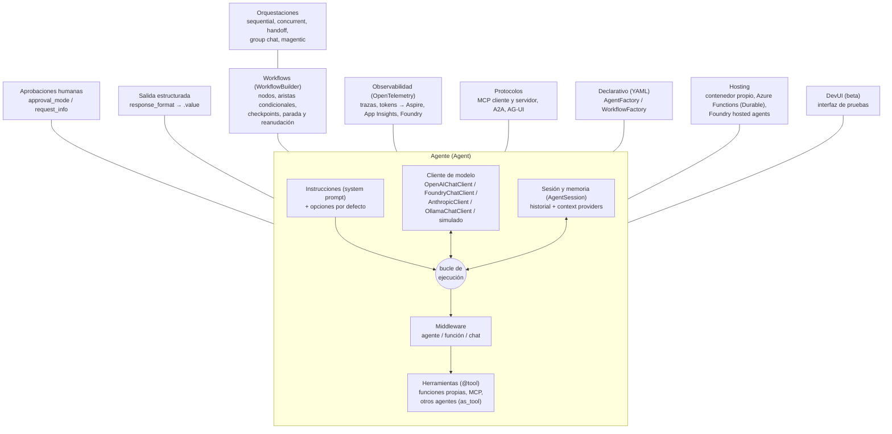
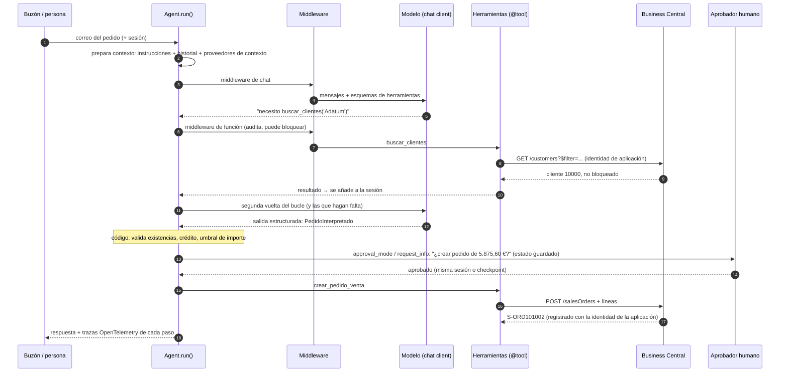
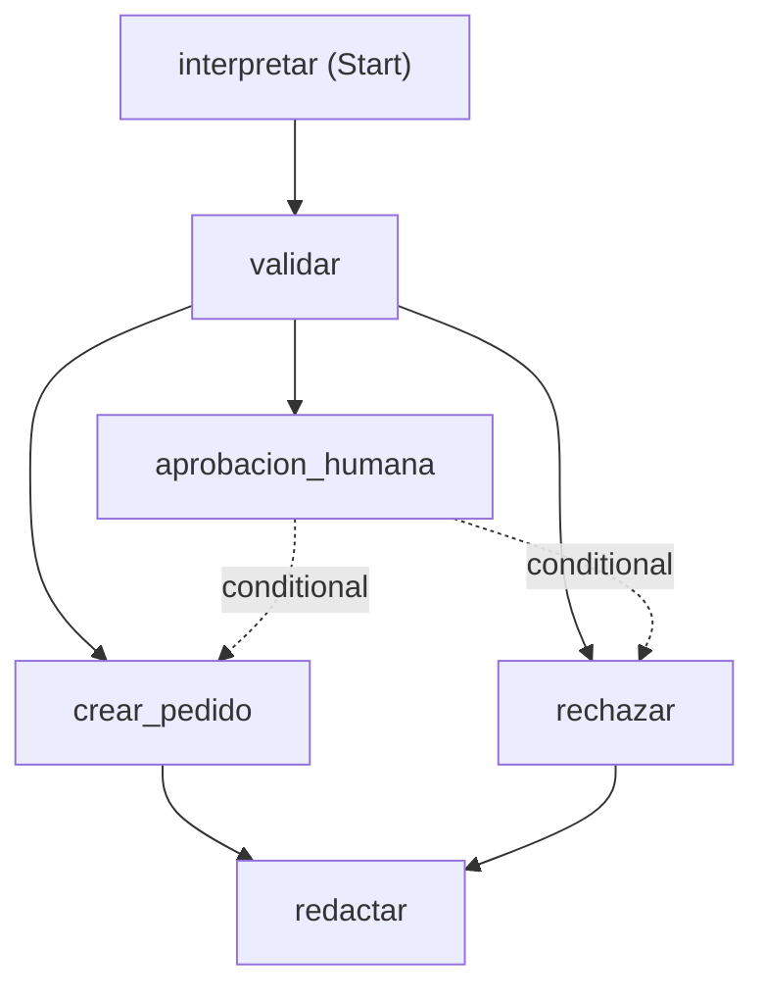

# Arquitectura: los tres diagramas

Los mismos diagramas del artículo, en Mermaid, para copiarlos donde haga falta. Nombres de la API de Agent Framework 1.22.0 (Python).

## 1. El esqueleto de un agente en Agent Framework

En este repositorio: el agente y sus instrucciones en `agentes.py` y `prompts/`; el cliente de modelo en `modelo.py`; las herramientas en `herramientas.py`; la sesión en `cli.py` (comando `chat`); el middleware en `middleware.py`; la salida estructurada en `esquemas.py`; el workflow con aprobación y checkpoints en `workflow.py`; la observabilidad en `observabilidad.py`; MCP en `mcp_server.py`; DevUI en `devui/`.

## 2. El recorrido de una petición

## 3. El workflow del ejemplo (generado por `WorkflowViz(workflow).to_mermaid()`)

Las tres aristas que salen de `validar` forman un grupo switch-case evaluado en código: `not apto_para_crear` → `rechazar`; `requiere_aprobacion` → `aprobacion_humana`; por defecto → `crear_pedido`. Las dos aristas de `aprobacion_humana` dependen de `DecisionTomada.aprobado`.

## 4. Quién decide qué

| Paso | Quién decide | Pieza |
|---|---|---|
| Qué cliente y qué artículos nombra el correo | IA | `Agent` intérprete + `@tool` de lectura + salida estructurada |
| Si el pedido es válido y cuánto importa | Código | `politicas.validar_pedido` |
| Qué ruta sigue el pedido | Código | aristas condicionales del `WorkflowBuilder` |
| Si se crea un pedido que exige aprobación | Persona | `request_info` + checkpoint (o `approval_mode` en el agente de chat) |
| Escribir en Business Central | Código | nodo `crear_pedido` → `ClienteBC.crear_pedido_venta` (API v2.0 con identidad de aplicación) |
| Qué se le dice al cliente | IA (sobre datos calculados por código) | `Agent` redactor |
| Qué queda registrado | Código | middleware de auditoría + OpenTelemetry + registro de cambios de BC |

La salida real de `python -m agente_pedidos demo` está en [`salida-demo.txt`](salida-demo.txt).
